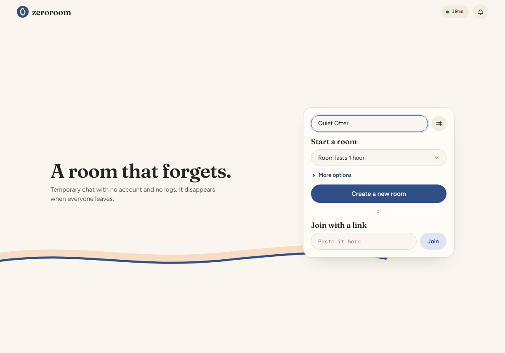
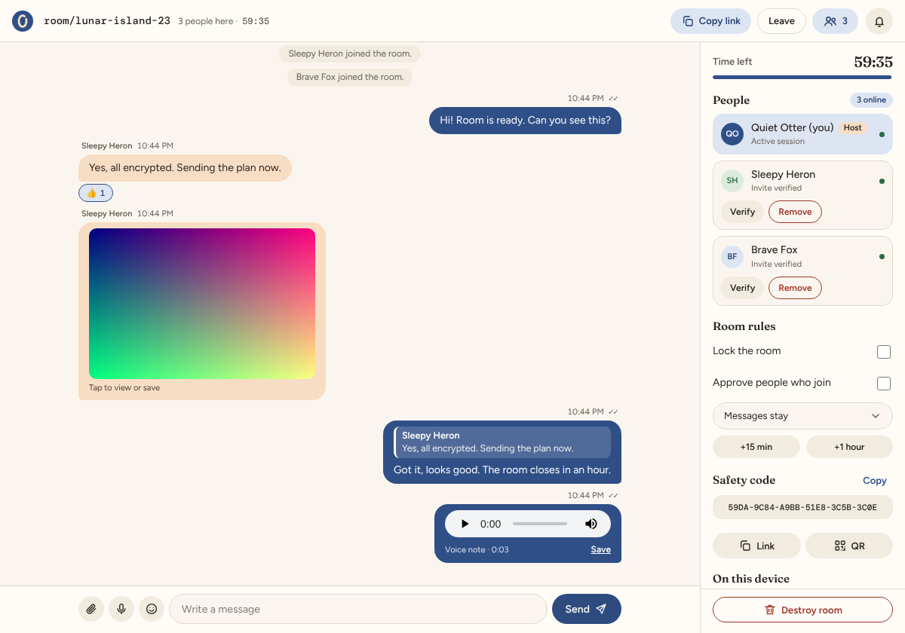
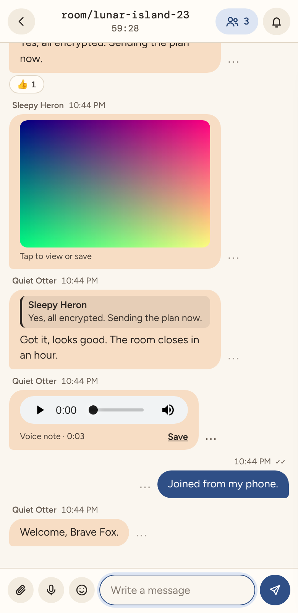
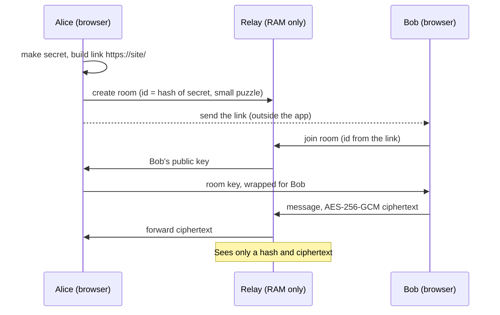

# ZeroRoom

**A private chat room that forgets.** No account, no database, no history. Create a room, share a link,
chat with end-to-end encryption. When the room ends, everything is gone.

<p align="center"></p>

## What it is

A small self-hosted web app in two parts: a **static web client** that does all the encryption in the
browser, and a **tiny Node.js relay** that only forwards encrypted messages and keeps rooms in RAM.
Good for short, throwaway conversations: a sensitive message to a friend, a quick group chat, or moving a
link or file between two devices.

<table>
  <tr>
    <td></td>
    <td></td>
  </tr>
</table>

## How it works



The part of the link after `#` never leaves the browser, so the relay cannot read anything.

| Who | Can see |
| --- | --- |
| Your browser | Everything in the room |
| The relay | Ciphertext, who is connected, when, how much, and IP addresses |
| Someone with the link | Everything (the link is the key, share it carefully) |
| Someone without the link | Nothing |

## Features

| Area | What you get |
| --- | --- |
| Rooms | Lasts 15 min, 1 h or 24 h (host can add time, max 24 h), invite by link, code, QR or share sheet, optional passphrase, up to 20 people |
| Messages | Replies, 6 reactions, delete for everyone, disappearing messages (30 s to 24 h), images, files up to 2 MB, voice notes up to 2 min |
| Host | Remove people, lock the room, approve each joiner, extend or destroy the room |
| Privacy | 10-digit pair codes to verify people, panic key (`Esc` twice), blur when the window loses focus, notifications without message text |
| Robustness | Proof-of-work on room creation, rate limits, auto-reconnect, installable as an app (PWA) |

## Quick start

Needs [Node.js 22+](https://nodejs.org/).

```bash
cd Zero-Room.net && npm install && cd ..
node run-local.mjs        # or run-local.bat on Windows, then open http://localhost:3000
```

Open it in two windows, create a room in one and paste the invite link into the other.
Tests: `cd Zero-Room.net && npm test`.

## Project layout

```
Zero-Room.net/   Node.js relay (WebSocket) and tests
Zero-Room.web/   static browser client (no build step)
deploy/          nginx, systemd and server steps (see deploy/DEPLOY.md, placeholder hostname chat.example.com)
docs/            screenshots used in this README
```

**Limits:** it hides message content, not the fact that you are connected. As with any browser-based
encrypted app, you must trust the server that delivers the page. Details in
[`Zero-Room.net/README.md`](Zero-Room.net/README.md).

Relay under the MIT license. Third-party code and fonts: [`Zero-Room.web/vendor/LICENSES.txt`](Zero-Room.web/vendor/LICENSES.txt).
